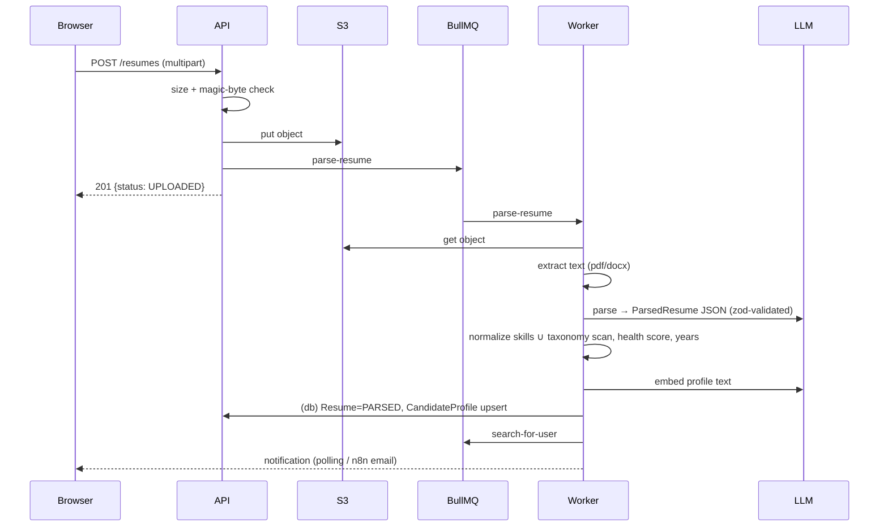
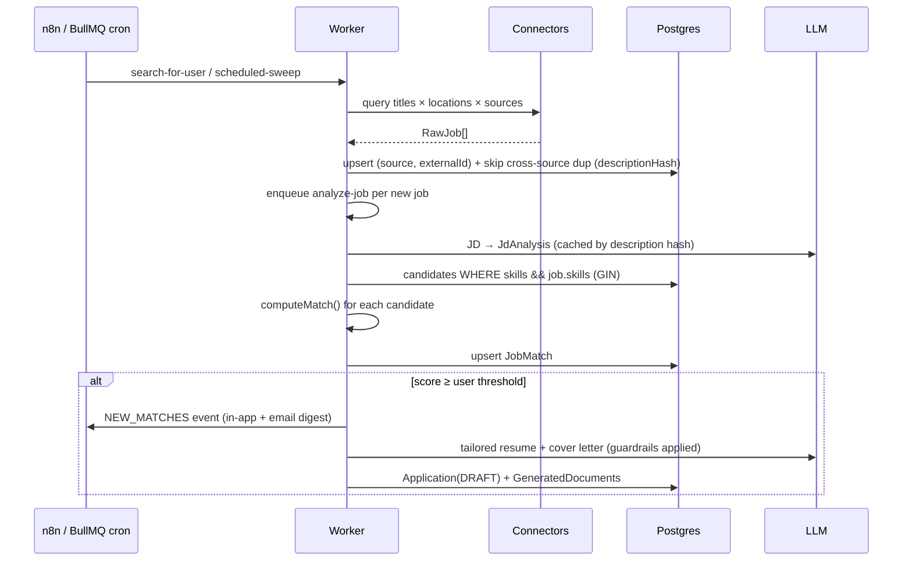

# Architecture

## 1. High-Level Design (HLD)

```mermaid
flowchart LR
  subgraph Client
    U[Browser<br/>Next.js 14 App Router<br/>React Query + ShadCN]
    EXT[Browser extension / bookmarklet<br/>(posts page HTML)]
  end

  subgraph Vercel
    WEB[Next.js server<br/>Auth.js v5 (JWT sessions)]
  end

  subgraph "Render / Railway"
    API[NestJS API<br/>REST /api/v1]
    WRK[NestJS Worker<br/>BullMQ processors + schedulers]
  end

  subgraph Data
    PG[(Neon PostgreSQL<br/>Prisma)]
    RD[(Redis<br/>queues + cache + quotas)]
    S3[(S3-compatible storage<br/>resumes + DOCX exports)]
  end

  subgraph AI["AI layer (provider router)"]
    OA[OpenAI<br/>chat + embeddings]
    AN[Anthropic Claude]
    GM[Google Gemini]
  end

  subgraph Automation
    N8N[n8n<br/>schedules, digests,<br/>follow-ups, email]
  end

  subgraph Sources["Job sources"]
    APIS[Remotive · RemoteOK · Adzuna]
    ATS[Greenhouse · Lever · Ashby<br/>career pages]
    IMP[URL / paste import<br/>LinkedIn · Naukri · Indeed · Wellfound<br/>Instahyre · Hirist · Foundit]
  end

  U --> WEB
  U -- Bearer JWT --> API
  EXT --> API
  WEB -- OAuth exchange (x-internal-key) --> API
  API --> PG & RD & S3
  API -- enqueue --> RD
  RD -- consume --> WRK
  WRK --> PG & S3
  WRK --> OA & AN & GM
  API --> OA & AN & GM
  WRK --> APIS & ATS
  API --> IMP
  N8N -- x-internal-key --> API
  API -- events --> N8N
```

### Components

| Layer | Responsibility | Tech |
|---|---|---|
| Frontend | Landing, auth, dashboard, job feed, JD analyzer, resume manager, document viewer, tracker | Next.js 14, React 18, TypeScript, Tailwind, ShadCN, React Query, Recharts |
| Auth | Email/password + Google/GitHub OAuth. Auth.js holds the session; the API issues its own JWT | Auth.js v5, `@nestjs/jwt`, bcrypt |
| API | Stateless REST, validation, authorization, orchestration | NestJS 10, zod, Swagger, Helmet, Throttler, Pino |
| Worker | Resume parsing, job ingestion, JD analysis, match fan-out, document generation, schedules | BullMQ (same codebase, separate process) |
| AI layer | Provider routing + fallback, JSON-schema validated output with self-repair, prompt-hash caching, quotas, token accounting | OpenAI, Anthropic, Gemini SDKs |
| Matching engine | Deterministic, explainable 0–100 score + ATS score | Pure TS (`matching.engine.ts`), embeddings optional |
| Data | Relational core, arrays for skills (GIN-indexed), JSON for AI artifacts | PostgreSQL (Neon), Prisma 5 |
| Cache | AI responses (7d), embeddings (30d), dashboard (5 min), quotas, rate counters | Redis |
| Storage | Original resumes, generated DOCX; private bucket, presigned GETs (5 min) | S3 / R2 / MinIO |
| Workflows | Time-based and channel-based automation; owns *when* and *how to deliver*, never business logic | n8n |

### Key design decisions

1. **LLMs extract, code decides.** The LLM turns unstructured text into structured data (skills, years, keywords). The match score itself is computed deterministically, so it's reproducible, explainable in the UI, unit-tested, and costs nothing to recompute for every user × job pair.
2. **Honesty is enforced in code, not just prompts.** `documents/guardrails.ts` diff-checks every tailored resume against the parsed source: unknown skills, roles, projects and invented metrics are removed and reported to the user.
3. **API owns logic, n8n owns orchestration.** Workflows call thin `/internal/*` endpoints. Swapping n8n for Temporal or cron later doesn't touch business rules.
4. **One codebase, two processes.** API and worker share modules but scale independently (`main.ts` vs `worker.ts`).
5. **Compliant sourcing.** Public, documented APIs and ATS board feeds are crawled. LinkedIn/Naukri/Indeed/etc. are supported via user-initiated import (URL → schema.org `JobPosting` JSON-LD, pasted text, or the HTML of a page the user is already viewing). No logged-in scraping, no ToS violations, no account bans for users.
6. **Provider-agnostic AI.** Any of the three providers can be primary; failures fall through the chain automatically.

---

## 2. Low-Level Design (LLD)

### Backend module map (`apps/api/src`)

```
core/            PrismaService, CacheService (Redis), StorageService (S3), CoreModule (global)
config/          zod-validated env, typed AppConfig
common/          AuthGuard (JWT + internal key), @Public/@Internal/@CurrentUser, ZodPipe, exception filter
modules/
  auth/          register, login, OAuth upsert (internal), me
  profile/       candidate profile + job preferences
  resumes/       upload, text extraction (pdf-parse / mammoth), parsing pipeline, health score, years-of-experience
  ai/            provider adapters, AiService (router/cache/quota/validation), prompt library
  matching/      matching.engine (pure), MatchingService (features, persistence, fan-out)
  jobs/          connectors (Remotive, RemoteOK, Adzuna, Greenhouse, Lever, Ashby, URL import), ingest/dedupe, JD analysis, feed
  documents/     tailored resume, cover letter, outreach, interview prep, guardrails, DOCX renderer, application drafts
  applications/  tracker CRUD, events timeline, interviews, follow-up scheduling
  dashboard/     aggregated, cached stats
  notifications/ in-app notifications + n8n event forwarding
  internal/      n8n-facing endpoints
  queue/         BullMQ registration + QueueService producer facade
workers/         processors (resume, jobs, pipeline, notifications), WorkerModule
```

### Queues

| Queue | Jobs | Concurrency | Notes |
|---|---|---|---|
| `resume` | `parse-resume` | 4 | 3 attempts, exponential backoff |
| `jobs` | `search-for-user`, `scheduled-sweep` (cron `0 */4 * * *`) | 3, rate-limited 20/min | dedup: one search per user per 10 min |
| `pipeline` | `analyze-job`, `auto-docs` | 5 | idempotent job IDs |
| `notifications` | `follow-up-sweep` (09:00 IST) | 2 | |

### Sequence — Workflow 1: resume upload → profile



### Sequence — Workflows 2 & 3: discovery → match → drafts



### Matching algorithm

```
score = Σ wᵢ·cᵢ / Σ wᵢ    (components without data, e.g. no embeddings, are dropped from both sums)

required skills  40   |matched ∩ required| / |required|      (aliases normalized: ReactJS = React)
preferred skills 10   same for nice-to-haves
experience       15   1 if years ≥ min; linear penalty below; 0.7 if > max+4 (over-qualified)
title            10   token overlap of target roles vs job title (seniority words ignored)
semantic         15   cosine(profile, job) rescaled from [0.2, 0.7] → [0, 1]
location/visa    10   remote fit, preferred cities, visa hard-zero

hard gate: ≥4 required skills and < 50% covered → score capped at 55
ATS score = 70% literal ATS-keyword coverage in resume text + 30% required-skill coverage
```

### AI gateway contract

`AiService.generateJson(schema, {system, user}, {feature, userId})`:

1. Cache lookup by `sha256(system, user)` (skipped for creative outputs).
2. Quota check (FREE plan: `FREE_PLAN_MONTHLY_AI_CALLS`/month via Redis counter).
3. For each configured provider in order: call with JSON mode → parse → zod validate → on failure, one repair round with the validation errors → on failure, next provider.
4. Persist `AiUsage` (provider, model, tokens, latency, success) for cost dashboards.

Prompt-injection hardening: resumes and JDs are wrapped in `<resume>` / `<job_description>` tags and every system prompt states that tagged content is data.

---

## 3. Database design

16 tables. Skills are stored as canonical `text[]` with GIN indexes for overlap queries; AI artifacts as `jsonb` validated by shared zod schemas.

```mermaid
erDiagram
  User ||--o| CandidateProfile : has
  User ||--o| JobPreference : has
  User ||--o{ OAuthAccount : links
  User ||--o{ Resume : uploads
  User ||--o{ JobMatch : receives
  User ||--o{ Application : tracks
  User ||--o{ GeneratedDocument : owns
  User ||--o{ Notification : gets
  User ||--o{ AiUsage : consumes
  User ||--o{ SavedSearch : saves
  Company ||--o{ Job : posts
  Job ||--o{ JobMatch : scored_in
  Job ||--o{ Application : applied_via
  Job ||--o{ GeneratedDocument : tailored_for
  Resume ||--o{ GeneratedDocument : source_of
  Application ||--o{ ApplicationEvent : timeline
  Application ||--o{ Interview : schedules
  Application ||--o{ GeneratedDocument : attaches

  User { string id PK; string email UK; string passwordHash; enum plan; enum role }
  CandidateProfile { string userId FK,UK; float totalYearsExp; text[] skills "GIN"; text[] primaryRoles; float[] embedding; int resumeHealth; string activeResumeId }
  JobPreference { string userId FK,UK; text[] titles; text[] locations; bool remoteOnly; bool needsVisaSponsorship; int minMatchScore; bool autoGenerateDocs }
  Resume { string id PK; string storageKey; enum status; text rawText; jsonb parsed; int healthScore; jsonb healthReport }
  Company { string id PK; string slug UK; string atsType; string atsBoardId }
  Job { string id PK; string source; string externalId; string descriptionHash; jsonb analysis; text[] requiredSkills "GIN"; float minYears; float[] embedding; enum workMode; bool visaSponsorship }
  JobMatch { string userId FK; string jobId FK; int score; int atsScore; jsonb breakdown; text[] missingSkills; bool saved; bool dismissed }
  GeneratedDocument { string id PK; enum type; int version; jsonb content; int atsScoreBefore; int atsScoreAfter; text[] guardrailFlags; string storageKey }
  Application { string id PK; string company; string role; string source; enum status; datetime appliedAt; datetime followUpAt; string recruiterName; bool responded; int matchScore }
  ApplicationEvent { string id PK; string type; string fromStatus; string toStatus; string message }
  Interview { string id PK; string round; datetime scheduledAt; string outcome }
  Notification { string id PK; string type; datetime readAt }
  AiUsage { string id PK; string feature; string provider; int inputTokens; int outputTokens; int latencyMs }
```

Unique constraints: `Job(source, externalId)`, `JobMatch(userId, jobId)`, `OAuthAccount(provider, providerAccountId)`. Full DDL: [`apps/api/prisma/migrations`](../apps/api/prisma/migrations).

---

## 4. Security

- Passwords: bcrypt (cost 12), timing-equalized login.
- API auth: HS256 JWT (7d, issuer-checked); internal endpoints require `x-internal-key` (constant-time compare).
- Per-route rate limits (login 10/min, uploads 10/h, AI generation 40/h) + global 120/min.
- Uploads: 5 MB cap, magic-byte sniffing, private bucket, short-lived presigned downloads.
- URL import: SSRF guard (no private/loopback/link-local hosts), 15s timeout, 2 MB cap.
- Helmet, strict CORS, security headers on the web app, secrets redacted from logs.
- Tenant isolation: every query is scoped by `userId` from the verified token.

## 5. Scalability path

| Load | Change |
|---|---|
| 1k users | Defaults: 1 API, 1 worker, Neon free/launch tier |
| 10k users | 2–3 API replicas, 2 workers, Neon autoscaling, Redis 1 GB |
| 100k users | Move embeddings to `pgvector` + HNSW for ANN candidate retrieval; split `pipeline` queue workers; read replica for dashboard; per-source connector workers |
| 1M users | Event bus (Kafka/SQS) between ingest and matching; dedicated matching service; partition `JobMatch` by user hash |
